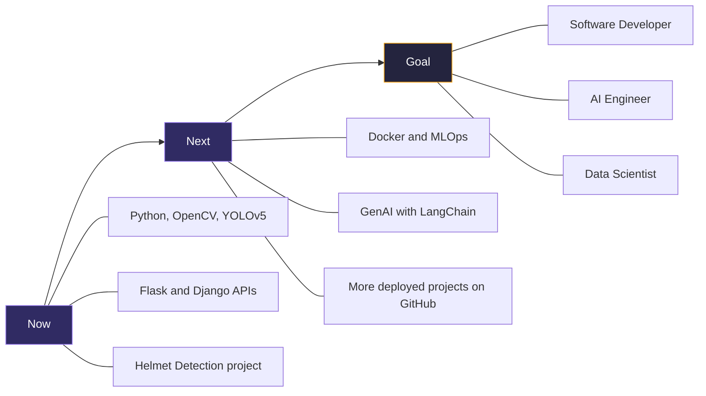

<div align="center">


</div>

<div align="center">

[](https://git.io/typing-svg)

</div>

<div align="center">

[](https://balamurugan2003.framer.website/)
[](https://linkedin.com/in/balamurugan-s10)
[](mailto:balamurugan.s.career@gmail.com)
[](https://github.com/BalamuruganS-MCA)

</div>

<br/>


<br/>

##  &nbsp;About Me


MCA (Data Science) graduate focused on machine learning, computer vision, and AI applications. I have industry exposure to secure, API-based systems from my time as a Trainee Engineer at **KyndleIT Consulting**, where I supported a Bank of Baroda authentication deployment.

I'm looking for roles as a **Software Developer, AI Engineer, or Data Scientist**.

<div align="center">

**`Python`** · **`OpenCV`** · **`YOLOv5`** · **`Scikit-learn`** · **`Flask`** · **`Django`** · **`MySQL`** · **`MongoDB`** · **`PyQt5`**

</div>

<br/>


<br/>

##  &nbsp;Tech Stack

<div align="center">

<table>
<tr>
<td align="center" width="96">

<br><b>Python</b>
</td>
<td align="center" width="96">

<br><b>C++</b>
</td>
<td align="center" width="96">

<br><b>MySQL</b>
</td>
<td align="center" width="96">

<br><b>MongoDB</b>
</td>
<td align="center" width="96">

<br><b>OpenCV</b>
</td>
<td align="center" width="96">

<br><b>TensorFlow</b>
</td>
<td align="center" width="96">

<br><b>Scikit-learn</b>
</td>
</tr>
<tr>
<td align="center" width="96">

<br><b>Pandas</b>
</td>
<td align="center" width="96">

<br><b>NumPy</b>
</td>
<td align="center" width="96">

<br><b>Flask</b>
</td>
<td align="center" width="96">

<br><b>Django</b>
</td>
<td align="center" width="96">

<br><b>Postman</b>
</td>
<td align="center" width="96">

<br><b>Git</b>
</td>
<td align="center" width="96">

<br><b>GitHub</b>
</td>
</tr>
</table>

</div>

<br/>

<div align="center">


</div>

<br/>

<details>
<summary><b>&nbsp;Full Skills Breakdown</b></summary>
<br/>

| Category | Technologies |
|:---|:---|
| **Programming** | Python, C++, SQL |
| **ML & Data Science** | Machine Learning, Computer Vision (OpenCV, YOLOv5), OCR, Scikit-learn, Data Analysis |
| **Backend & APIs** | Flask, Django, RESTful APIs, SOAP, Postman, API Testing |
| **Databases** | MySQL, MongoDB |
| **Security** | Multi-Factor Authentication (MFA), Symantec Advanced Authentication, Network Security, Cisco CCNA |
| **Tools & Design** | Git, PyQt5, Adobe Illustrator, Adobe Photoshop |

</details>

<br/>


<br/>

##  &nbsp;Flagship Project

<div align="center">

### `PRAKA` — Brand Identity & Packaging Design

[](https://www.prakafoods.in/)

</div>

> **Packaging and brand identity design for a millet-based food product line**

<table>
<tr>
<td width="55%" valign="top">

#### What I Did
- 🎨 **Designed** the product packaging and brand identity
- 🤝 **Collaborated** with a cross-functional team to keep branding consistent
- ⏱️ **Delivered** on a tight deadline

#### Impact
```diff
+ 15% increase in product visibility
+ Consistent branding across the product line
+ Delivered within a tight deadline
```

</td>
<td width="45%" valign="top">

#### 📋 Project Snapshot
<table>
<tr><td><b>Product</b><br>🌾 Millet-based food brand</td></tr>
<tr><td><b>Duration</b><br>📅 Aug 2024 – Oct 2024</td></tr>
<tr><td><b>Work</b><br>🎨 Packaging & brand identity</td></tr>
<tr><td><b>Team</b><br>🤝 Cross-functional collaboration</td></tr>
</table>

</td>
</tr>
</table>

<div align="center">

`Adobe Illustrator` `Adobe Photoshop` `Brand Design`

</div>

---

<details>
<summary><h3>&nbsp;📁 View All Projects →</h3></summary>
<br/>

#### Helmet Detection & Challan Issuance System &nbsp; `🟢 IN PROGRESS`

> Real-time computer vision pipeline for automated traffic-violation tracking. Sep 2025 – Present.

| | |
|:---|:---|
| **Impact** | 95%+ accuracy · designed for deployment across multiple traffic zones |
| **How** | YOLOv5 helmet detector + OCR license-plate module + PyQt5 desktop interface |
| **Stack** | `Python` `YOLOv5` `OpenCV` `OCR` `PyQt5` `Deep Learning` |

</details>

<br/>


<br/>

##  &nbsp;Why Hire Me

<table>
<tr>
<td width="55%" valign="top">

| Capability | Proof |
|:---|:---|
| 🧠 **Computer vision** | Real-time helmet and plate recognition, 95%+ accuracy |
| 🔐 **Secure systems** | MFA and authentication work for a Bank of Baroda deployment |
| ⚙️ **API testing** | SOAP and Postman testing on a live system |
| 📊 **Data science base** | MCA with 9.20 CGPA, IBM Data Science with Python |
| 🎨 **Design sense** | PRAKA packaging, 15% increase in product visibility |
| 🏆 **Competitions** | Finalist, Pickl.ai × TransOrg Analytics Hackathon |

</td>
<td width="45%" valign="top">

<div align="center">

### ⚡ Quick Statistics
<table>
<tr><td>📊 <b>9.20 CGPA</b>: MCA Data Science</td></tr>
<tr><td>🏆 <b>Hackathon Finalist</b> (2025)</td></tr>
<tr><td>🎯 <b>95%+ Accuracy</b> in the CV pipeline</td></tr>
<tr><td>🔐 <b>10,000+ Daily Transactions</b> supported</td></tr>
<tr><td>📋 <b>3 Certifications</b>: IBM, AWS, Quantum</td></tr>
</table>

</div>

</td>
</tr>
</table>

<br/>


<br/>

##  &nbsp;Experience & Education

<table>
<tr>
<td width="50%" valign="top">

### 💼 Experience

**Trainee Engineer**
*KyndleIT Consulting Pvt. Ltd., Bengaluru* · `Feb 2026 – Aug 2026`
- Supported MFA configuration and API testing (SOAP, Postman) for a Symantec Advanced Authentication deployment at Bank of Baroda
- Analyzed authentication logs to help flag and resolve security issues

</td>
<td width="50%" valign="top">

### 🎓 Education

| | |
|:---|:---|
| **MCA (Data Science)** | Takshashila University |
| *2024 – 2026* | **CGPA: 9.20 / 10** |
| | |
| **BCA** | Peri College of Arts and Science |
| *2021 – 2024* | **CGPA: 7.62 / 10** |

### 🏅 Certifications
- Data Science with Python — *IBM Developer Skills Network*
- Machine Learning Terminology and Process — *AWS Training & Certification*
- Quantum Computing — *Intensive course*

</td>
</tr>
</table>

<br/>

##  &nbsp;Achievements

<div align="center">


</div>

<br/>


<br/>

##  &nbsp;GitHub Analytics

<div align="center">


</div>

<div align="center">


</div>

<div align="center">


</div>

<div align="center">

[](https://github.com/ryo-ma/github-profile-trophy)

</div>

<br/>


<br/>

##  &nbsp;Currently Learning

<table>
<tr>
<td width="50%" valign="top">

**Generative AI & Machine Learning**
- Generative AI and LLM applications
- LangChain
- Deep Learning and Computer Vision, through the helmet detection system
- Machine learning workflows, through AWS training

</td>
<td width="50%" valign="top">

**MLOps & Engineering**
- MLOps and model deployment
- Docker and containerization
- Backend API development with Flask and Django
- Authentication and API security

</td>
</tr>
</table>

<div align="center">


</div>

<br/>

<details>
<summary><b>&nbsp;Career Roadmap</b></summary>
<br/>



</details>

<br/>


<br/>

##  &nbsp;Philosophy

```
① Turn models into working applications, not just experiments.
② Write clean code that another engineer can read and extend.
③ Aim for reliability and measurable results.
④ Keep learning by building real projects.
```

<br/>

##  &nbsp;Let's Connect

<div align="center">

*Open to roles as a Software Developer, AI Engineer, or Data Scientist.*

<br/>

[](https://balamurugan2003.framer.website/)
[](https://linkedin.com/in/balamurugan-s10)
[](https://github.com/BalamuruganS-MCA)
[](mailto:balamurugan.s.career@gmail.com)

📧 balamurugan.s.career@gmail.com

<br/>


<br/>


</div>
